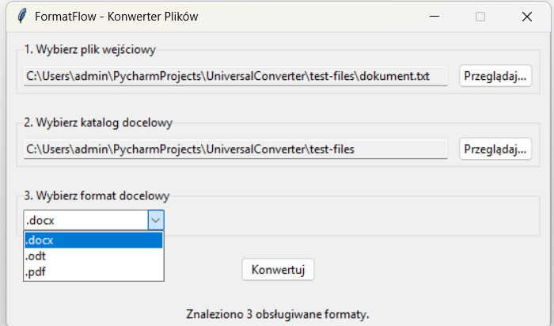
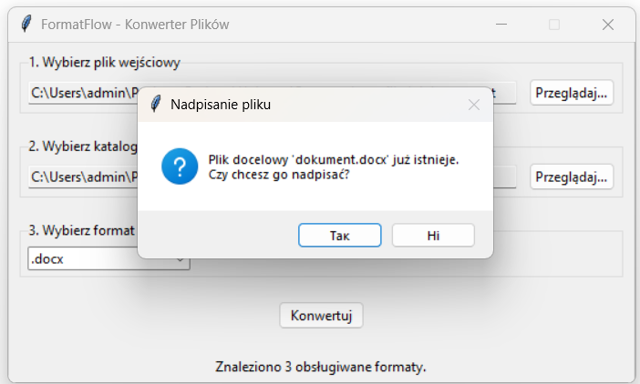

# FormatFlow - Konwerter Plików

Aplikacja desktopowa napisana w języku Python służąca do bezpiecznej i szybkiej konwersji danych strukturalnych oraz dokumentów tekstowych i biurowych.

## 🖼️ Zrzuty ekranu



## ⚙️ Zależności systemowe

Aplikacja została przetestowana w środowisku **Python 3.10+**.

Do obsługi konwersji dokumentów biurowych oraz plików PDF wymagana jest instalacja pakietu **LibreOffice**. Narzędzie musi być dostępne w zmiennej środowiskowej `PATH` lub zainstalowane w domyślnej lokalizacji:

* `C:\Program Files\LibreOffice\program\soffice.exe`
* `C:\Program Files (x86)\LibreOffice\program\soffice.exe`

## 🚀 Instrukcja instalacji i uruchomienia

```bash
   git clone https://github.com/ftryt/FileShift
   cd FileShift
   
   python -m venv venv
   .\venv\Scripts\activate
   
   pip install -r requirements.txt
   
   python main.py
 ```
